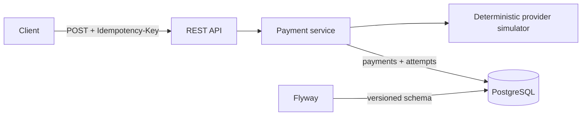

# Payment Gateway Reliability Simulator

A compact Java backend demonstrating reliability patterns used around payment APIs: idempotent creation, explicit state transitions, bounded retries, and durable attempt history.

> **This is a simulator, not a real payment processor.** It has no real provider integration and must only receive synthetic `tok_*` payment tokens—never card numbers, CVVs, or production data.

## Stack and architecture

Java 21, Spring Boot 3.5, Spring Web, Validation, Spring Data JPA, PostgreSQL 16, Flyway, H2 for tests, Maven, Docker Compose, and GitHub Actions.



Payment lifecycle:

```text
PENDING -> PROCESSING -> SUCCEEDED
                      -> DECLINED
                      -> FAILED
```

Terminal states cannot transition again. A permanent decline is not retried. A transient failure is retried synchronously up to `PAYMENTS_RETRY_MAX_ATTEMPTS` (default `3`) with linear backoff: `PAYMENTS_RETRY_BACKOFF_MS * failed attempt number`.

## Run on Windows

Prerequisites: JDK 21, Maven 3.9+, and optionally Docker Desktop with Compose.

Fast test run (H2 in PostgreSQL compatibility mode; no Docker required):

```powershell
mvn -B verify
```

Full stack with PostgreSQL:

```powershell
Copy-Item .env.example .env
# Replace POSTGRES_PASSWORD in .env with a local-only password.
docker compose up --build --wait
Invoke-RestMethod http://localhost:8080/actuator/health
```

To run the application directly against an existing PostgreSQL instance:

```powershell
$env:SPRING_DATASOURCE_URL = 'jdbc:postgresql://localhost:5432/payments'
$env:SPRING_DATASOURCE_USERNAME = 'payments'
$env:SPRING_DATASOURCE_PASSWORD = Read-Host 'PostgreSQL password'
mvn spring-boot:run
```

### Configuration

| Environment variable | Required | Purpose |
|---|---:|---|
| `SPRING_DATASOURCE_URL` | Yes outside Compose | PostgreSQL JDBC URL |
| `SPRING_DATASOURCE_USERNAME` | Yes outside Compose | Database user |
| `SPRING_DATASOURCE_PASSWORD` | Yes | Database password; never commit it |
| `POSTGRES_DB` | Compose default: `payments` | Compose database name |
| `POSTGRES_USER` | Compose default: `payments` | Compose database user |
| `POSTGRES_PASSWORD` | Yes for Compose | Compose database password |
| `PAYMENTS_RETRY_MAX_ATTEMPTS` | No, default `3` | Total provider attempts, including the first |
| `PAYMENTS_RETRY_BACKOFF_MS` | No, default `200` | Base linear backoff in milliseconds |

Flyway applies `V1__create_payment_tables.sql`. The named Compose volume `postgres-data` preserves payments and attempt history across container recreation and application restarts.

## API

| Method | Endpoint | Purpose |
|---|---|---|
| `POST` | `/api/v1/payments` | Create/process a simulated payment; requires `Idempotency-Key` |
| `GET` | `/api/v1/payments/{id}` | Retrieve a payment |
| `GET` | `/api/v1/payments/{id}/attempts` | Retrieve ordered provider-attempt history |
| `GET` | `/actuator/health` | Health check |

Create a payment:

```powershell
$headers = @{ 'Idempotency-Key' = 'demo-001' }
$body = @{
  merchantId = 'merchant_1'
  amountMinor = 2500
  currency = 'INR'
  paymentMethodToken = 'tok_flaky_once'
} | ConvertTo-Json

$payment = Invoke-RestMethod -Method Post `
  -Uri http://localhost:8080/api/v1/payments `
  -Headers $headers -ContentType 'application/json' -Body $body
$payment
Invoke-RestMethod "http://localhost:8080/api/v1/payments/$($payment.id)/attempts"
```

Example create response (IDs and timestamps vary):

```json
{
  "id": "8eed3708-6ecf-4374-89ba-e5f3b69327e4",
  "status": "SUCCEEDED",
  "merchantId": "merchant_1",
  "amountMinor": 2500,
  "currency": "INR",
  "failureCode": null,
  "attemptCount": 2,
  "createdAt": "2026-10-23T10:00:00Z",
  "updatedAt": "2026-10-23T10:00:00.200Z"
}
```

The first valid request returns `201 Created`. Repeating the same key and payload returns the original payment with `200 OK` and `Idempotent-Replayed: true`; it does not call the provider again. Reusing the key with a different payload returns `422 Unprocessable Entity`. A database unique constraint protects the key, but concurrent same-key requests are not covered by a concurrency test, so this project does not claim concurrent-idempotency safety.

Provider behavior is deterministic:

| Token | Result |
|---|---|
| `tok_success` or another valid `tok_*` token | Success on attempt 1 |
| `tok_flaky_once` | One transient failure, then success |
| `tok_flaky_twice` | Two transient failures, then success |
| `tok_timeout` | Transient failure until retries are exhausted; payment becomes `FAILED` |
| `tok_decline` | Permanent decline on attempt 1; payment becomes `DECLINED` |

Each provider call is stored immediately in `payment_attempts` with its sequence number, outcome, error code, and timestamp. More ready-to-run examples are in [`requests.http`](requests.http).

## Tests, database, and cleanup

CI runs `mvn -B verify` on every push and pull request with Java 21. The automated integration suite uses isolated H2, not PostgreSQL.

Inspect the Compose database without publishing its port:

```powershell
docker compose exec postgres psql -U payments -d payments `
  -c 'select id, status, amount_minor, currency from payments;'
docker compose exec postgres psql -U payments -d payments `
  -c 'select payment_id, attempt_number, outcome, error_code from payment_attempts order by payment_id, attempt_number;'
```

Stop containers while retaining data, then start again to check persistence:

```powershell
docker compose down
docker compose up -d --wait
```

Remove the local database volume only when you intentionally want a clean slate:

```powershell
docker compose down --volumes
```

## Known limitations

- H2 tests validate application behavior; there is no Testcontainers/PostgreSQL integration suite.
- Provider calls and retries are synchronous; there is no queue, circuit breaker, or recovery worker for a process interrupted in `PROCESSING`.
- Concurrent idempotency behavior is not tested. An in-flight replay may return `PROCESSING`.
- No authentication, authorization, rate limiting, real payment integration, or PCI scope is implemented.
- A production evolution would add PostgreSQL/Testcontainers tests, authentication, observability, asynchronous recovery, and idempotency concurrency tests.
